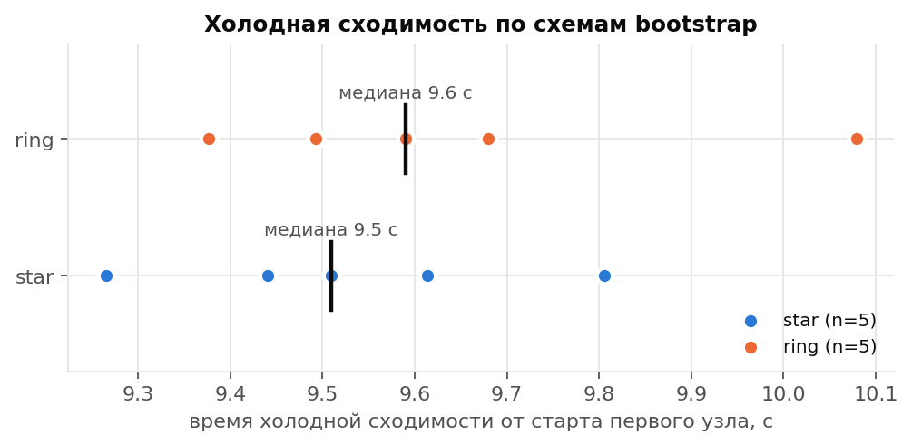
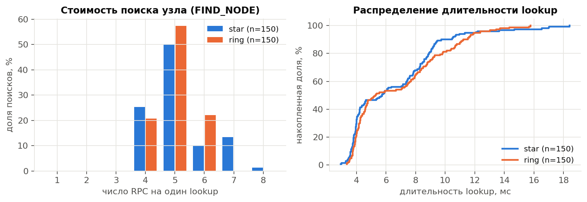
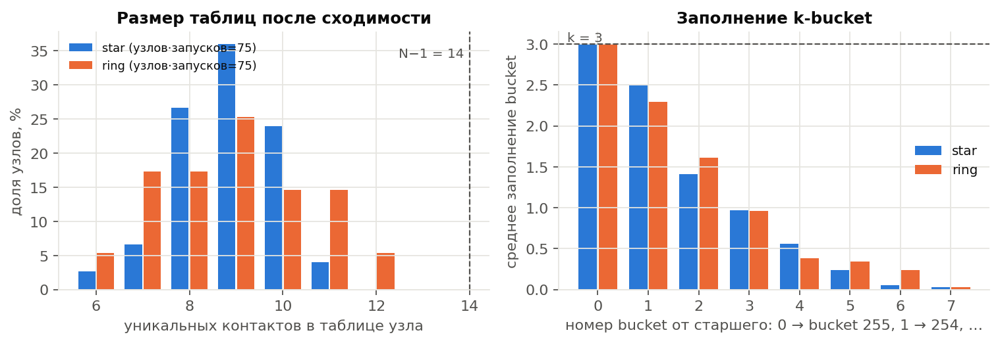
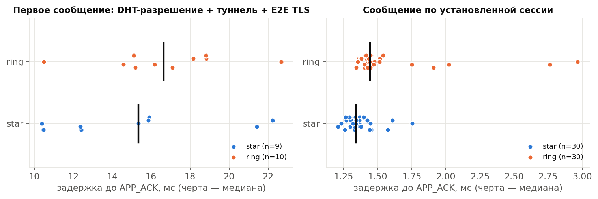
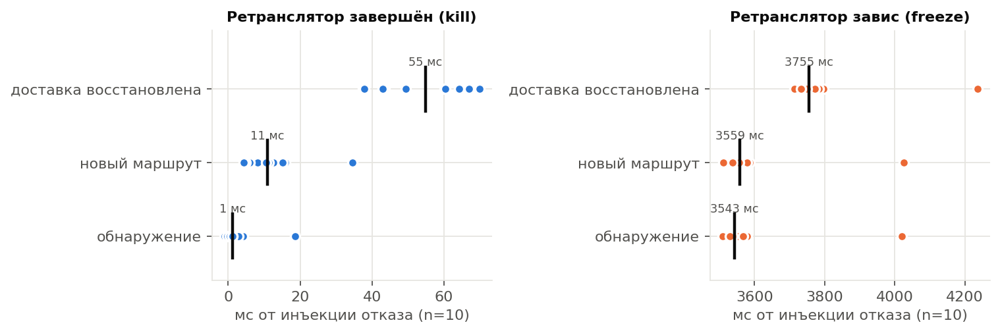
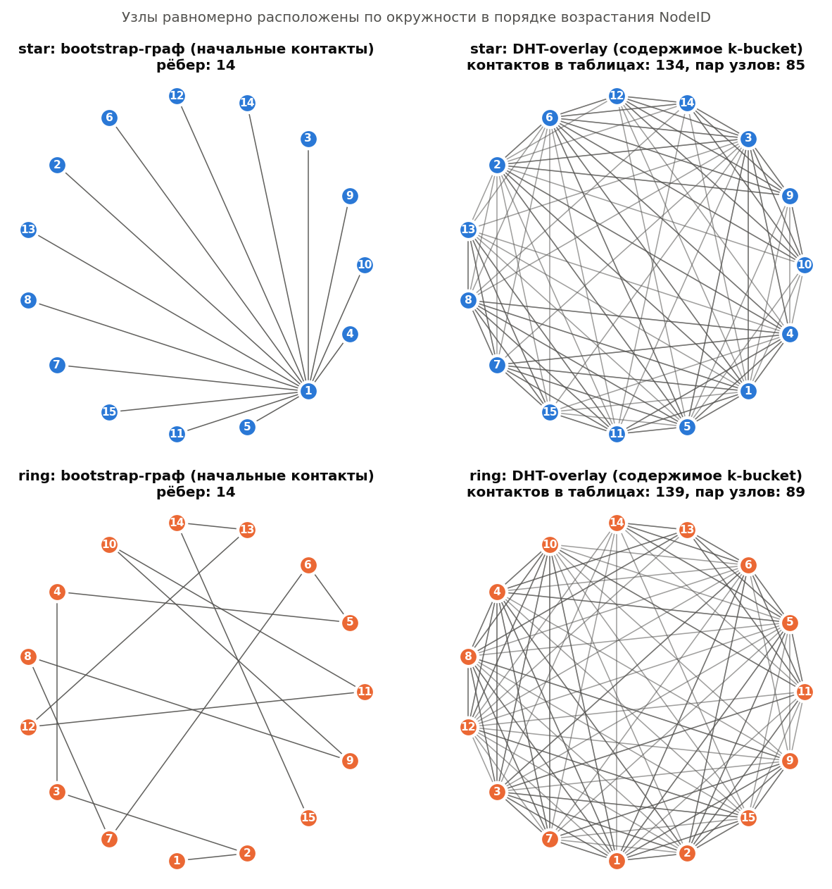

# Результаты серии `experiments-20261026-043134`

Версия кода: `f0aecfc`; N=15, k=3, ALPHA=3, R=3; исследуемый фактор — схема bootstrap (star, ring); 5 холодных запусков на схему; полная батарея отказов — в запуске 1 каждой схемы.

## Схема star

| Показатель | n | min | max | медиана | среднее | p95 |
|---|---:|---:|---:|---:|---:|---:|
| Холодная сходимость, с | 5 | 9.27 | 9.81 | 9.51 | 9.53 | n<20 |
| Присоединение всех узлов, с | 5 | 8.99 | 9.52 | 9.22 | 9.25 | n<20 |
| Раундов до сходимости | 5 | 2 | 2 | 2 | 2 | n<20 |
| Контактов в таблице узла | 75 | 6.0 | 11.0 | 9.0 | 8.8 | 10.0 |
| Lookup: длительность, мс | 150 | 2.9 | 18.4 | 5.7 | 6.5 | 11.7 |
| Lookup: RPC | 150 | 4.0 | 8.0 | 5.0 | 5.2 | 7.0 |
| Lookup: итераций | 150 | 2.0 | 3.0 | 2.0 | 2.1 | 3.0 |
| Lookup: промежуточных узлов | 150 | 3.0 | 7.0 | 4.0 | 4.2 | 6.0 |
| Отказ промежуточного узла: lookup, мс | 5 | 2026.6 | 2045.3 | 2030.0 | 2032.7 | n<20 |
| Отказ хранителя: FIND_VALUE, мс | 5 | 2013.9 | 2038.3 | 2024.6 | 2024.1 | n<20 |
| Построение туннеля, мс | 9 | 2.5 | 7.8 | 4.9 | 4.5 | n<20 |
| Первое сообщение, мс | 9 | 10.4 | 22.2 | 15.3 | 15.2 | n<20 |
| Сообщение по установленной сессии, мс | 30 | 1.21 | 1.75 | 1.34 | 1.37 | 1.59 |
| Отказ ретранслятора (kill): обнаружение, мс | 5 | -1.0 | 4.1 | 1.3 | 1.1 | n<20 |
| Отказ ретранслятора (kill): восстановление доставки, мс | 5 | 37.5 | 66.9 | 60.2 | 54.5 | n<20 |
| Зависание ретранслятора: обнаружение, мс | 5 | 3536.4 | 3578.4 | 3554.8 | 3557.3 | n<20 |
| Зависание ретранслятора: восстановление доставки, мс | 5 | 3742.5 | 3797.3 | 3771.2 | 3771.1 | n<20 |

- Успешных контрольных lookup: **150/150**; цель отсутствовала в таблице инициатора во всех 150 из 150.
- Невырожденность (запуск 1): выполнена; узлов с < N−1 контактов: 100%; максимальная таблица 10 при N−1=14.
- Доставлено сообщений: 39/40 (недоставленные в статистику задержек не входят).
- FIND_VALUE после отказа хранителя: 5/5; lookup после отключения bootstrap: 10/10.
- Отказ ретранслятора: доставка восстановлена в 5/5 инъекций, новый маршрут без отказавшего узла — 5/5.

## Схема ring

| Показатель | n | min | max | медиана | среднее | p95 |
|---|---:|---:|---:|---:|---:|---:|
| Холодная сходимость, с | 5 | 9.38 | 10.08 | 9.59 | 9.64 | n<20 |
| Присоединение всех узлов, с | 5 | 9.09 | 9.80 | 9.29 | 9.36 | n<20 |
| Раундов до сходимости | 5 | 2 | 2 | 2 | 2 | n<20 |
| Контактов в таблице узла | 75 | 6.0 | 12.0 | 9.0 | 8.9 | 11.3 |
| Lookup: длительность, мс | 150 | 3.3 | 15.8 | 5.3 | 6.8 | 12.2 |
| Lookup: RPC | 150 | 4.0 | 6.0 | 5.0 | 5.0 | 6.0 |
| Lookup: итераций | 150 | 2.0 | 2.0 | 2.0 | 2.0 | 2.0 |
| Lookup: промежуточных узлов | 150 | 3.0 | 5.0 | 4.0 | 4.0 | 5.0 |
| Отказ промежуточного узла: lookup, мс | 5 | 2022.7 | 2041.8 | 2033.9 | 2031.7 | n<20 |
| Отказ хранителя: FIND_VALUE, мс | 5 | 2.0 | 2023.8 | 2011.8 | 1210.5 | n<20 |
| Построение туннеля, мс | 10 | 2.5 | 10.1 | 6.4 | 6.1 | n<20 |
| Первое сообщение, мс | 10 | 10.5 | 22.7 | 16.6 | 16.7 | n<20 |
| Сообщение по установленной сессии, мс | 30 | 1.34 | 2.97 | 1.44 | 1.57 | 2.43 |
| Отказ ретранслятора (kill): обнаружение, мс | 5 | 0.5 | 18.6 | 1.3 | 4.9 | n<20 |
| Отказ ретранслятора (kill): восстановление доставки, мс | 5 | 37.9 | 69.8 | 49.4 | 52.1 | n<20 |
| Зависание ретранслятора: обнаружение, мс | 5 | 3508.9 | 4019.6 | 3530.4 | 3623.6 | n<20 |
| Зависание ретранслятора: восстановление доставки, мс | 5 | 3714.1 | 4235.3 | 3734.1 | 3833.1 | n<20 |

- Успешных контрольных lookup: **150/150**; цель отсутствовала в таблице инициатора во всех 150 из 150.
- Невырожденность (запуск 1): выполнена; узлов с < N−1 контактов: 100%; максимальная таблица 12 при N−1=14.
- Доставлено сообщений: 40/40 (недоставленные в статистику задержек не входят).
- FIND_VALUE после отказа хранителя: 5/5; lookup после отключения bootstrap: 10/10.
- Отказ ретранслятора: доставка восстановлена в 5/5 инъекций, новый маршрут без отказавшего узла — 5/5.

Примечание. Длительности внутри узла (lookup, построение туннеля, RTT сообщения) измерены монотонными часами высокого разрешения. Времена отказа ретранслятора сравнивают системные часы оркестратора и узла (разрешение около 1 мс): значения 0 ± 1 мс означают обнаружение в пределах разрешения часов.

## Графики

