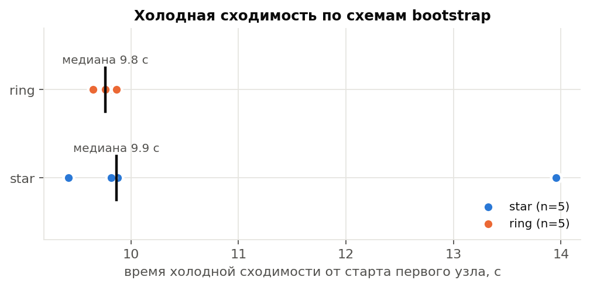
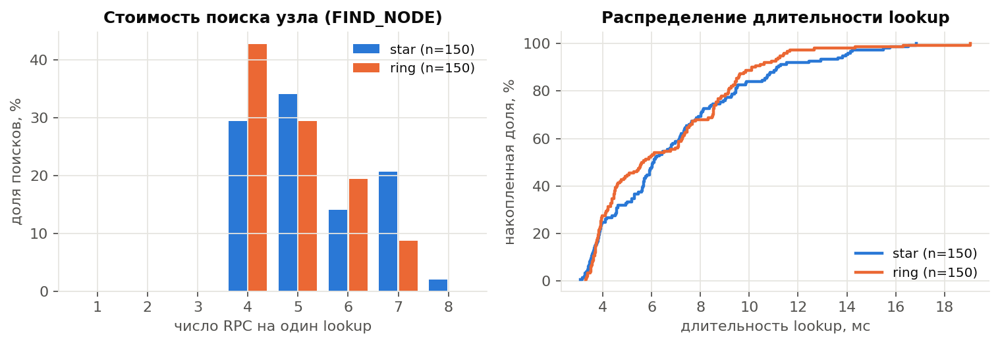
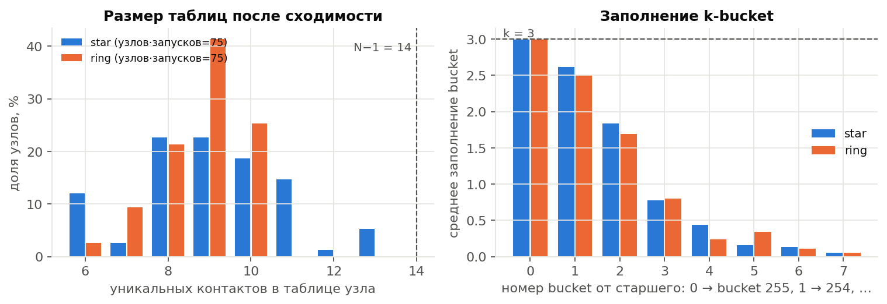
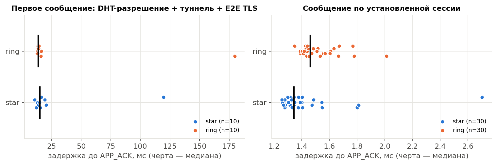
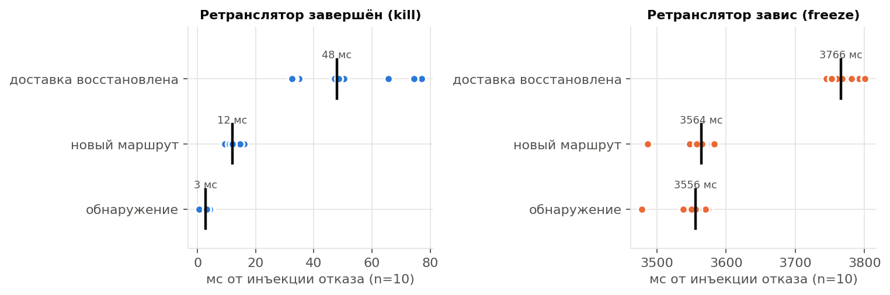
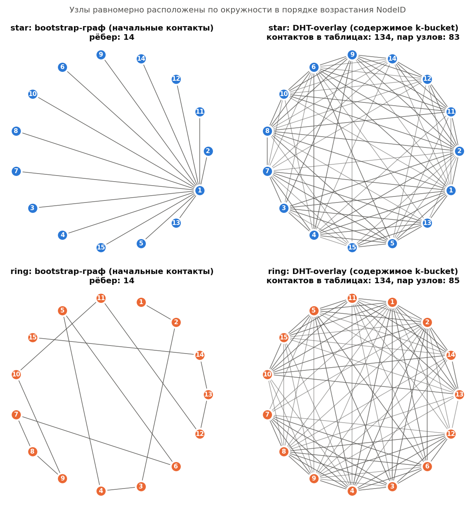

# Результаты серии `experiments-20261026-044748`

Версия кода: `902f68c`; N=15, k=3, ALPHA=3, R=3; исследуемый фактор — схема bootstrap (star, ring); 5 холодных запусков на схему; полная батарея отказов — в запуске 1 каждой схемы.

## Схема star

| Показатель | n | min | max | медиана | среднее | p95 |
|---|---:|---:|---:|---:|---:|---:|
| Холодная сходимость, с | 5 | 9.42 | 13.96 | 9.86 | 10.59 | n<20 |
| Присоединение всех узлов, с | 5 | 9.15 | 13.72 | 9.59 | 10.32 | n<20 |
| Раундов до сходимости | 5 | 2 | 2 | 2 | 2 | n<20 |
| Контактов в таблице узла | 75 | 6.0 | 13.0 | 9.0 | 9.1 | 12.3 |
| Lookup: длительность, мс | 150 | 3.1 | 16.9 | 6.1 | 6.9 | 13.9 |
| Lookup: RPC | 150 | 4.0 | 8.0 | 5.0 | 5.3 | 7.0 |
| Lookup: итераций | 150 | 2.0 | 3.0 | 2.0 | 2.2 | 3.0 |
| Lookup: промежуточных узлов | 150 | 3.0 | 7.0 | 4.0 | 4.3 | 6.0 |
| Отказ промежуточного узла: lookup, мс | 5 | 2036.0 | 2053.5 | 2038.8 | 2043.3 | n<20 |
| Отказ хранителя: FIND_VALUE, мс | 5 | 3.0 | 2036.5 | 2031.5 | 1624.9 | n<20 |
| Построение туннеля, мс | 10 | 2.6 | 7.7 | 5.1 | 5.0 | n<20 |
| Первое сообщение, мс | 10 | 10.7 | 119.4 | 15.2 | 25.6 | n<20 |
| Сообщение по установленной сессии, мс | 30 | 1.26 | 2.70 | 1.34 | 1.43 | 1.81 |
| Отказ ретранслятора (kill): обнаружение, мс | 5 | 0.6 | 4.5 | 3.0 | 2.8 | n<20 |
| Отказ ретранслятора (kill): восстановление доставки, мс | 5 | 32.8 | 50.4 | 34.9 | 39.7 | n<20 |
| Зависание ретранслятора: обнаружение, мс | 5 | 3478.4 | 3573.4 | 3561.8 | 3546.1 | n<20 |
| Зависание ретранслятора: восстановление доставки, мс | 5 | 3754.5 | 3792.4 | 3767.7 | 3770.1 | n<20 |

- Успешных контрольных lookup: **150/150**; цель отсутствовала в таблице инициатора во всех 150 из 150.
- Невырожденность (запуск 1): выполнена; узлов с < N−1 контактов: 100%; максимальная таблица 10 при N−1=14.
- Доставлено сообщений: 40/40 (недоставленные в статистику задержек не входят).
- FIND_VALUE после отказа хранителя: 5/5; lookup после отключения bootstrap: 10/10.
- Отказ ретранслятора: доставка восстановлена в 5/5 инъекций, новый маршрут без отказавшего узла — 5/5.

## Схема ring

| Показатель | n | min | max | медиана | среднее | p95 |
|---|---:|---:|---:|---:|---:|---:|
| Холодная сходимость, с | 5 | 9.65 | 9.87 | 9.76 | 9.75 | n<20 |
| Присоединение всех узлов, с | 5 | 9.39 | 9.60 | 9.46 | 9.49 | n<20 |
| Раундов до сходимости | 5 | 2 | 2 | 2 | 2 | n<20 |
| Контактов в таблице узла | 75 | 6.0 | 10.0 | 9.0 | 8.8 | 10.0 |
| Lookup: длительность, мс | 150 | 3.3 | 19.1 | 5.6 | 6.5 | 11.3 |
| Lookup: RPC | 150 | 4.0 | 7.0 | 5.0 | 4.9 | 7.0 |
| Lookup: итераций | 150 | 2.0 | 3.0 | 2.0 | 2.1 | 3.0 |
| Lookup: промежуточных узлов | 150 | 3.0 | 6.0 | 4.0 | 3.9 | 6.0 |
| Отказ промежуточного узла: lookup, мс | 5 | 2028.5 | 2052.6 | 2045.7 | 2042.7 | n<20 |
| Отказ хранителя: FIND_VALUE, мс | 5 | 2032.7 | 2044.1 | 2035.0 | 2036.1 | n<20 |
| Построение туннеля, мс | 10 | 2.4 | 166.5 | 4.0 | 20.0 | n<20 |
| Первое сообщение, мс | 10 | 12.7 | 179.5 | 13.9 | 30.6 | n<20 |
| Сообщение по установленной сессии, мс | 30 | 1.35 | 2.01 | 1.46 | 1.52 | 1.77 |
| Отказ ретранслятора (kill): обнаружение, мс | 5 | 0.5 | 3.1 | 2.7 | 2.0 | n<20 |
| Отказ ретранслятора (kill): восстановление доставки, мс | 5 | 32.5 | 77.1 | 65.6 | 59.6 | n<20 |
| Зависание ретранслятора: обнаружение, мс | 5 | 3537.8 | 3559.4 | 3556.0 | 3551.8 | n<20 |
| Зависание ретранслятора: восстановление доставки, мс | 5 | 3744.7 | 3800.4 | 3759.8 | 3767.7 | n<20 |

- Успешных контрольных lookup: **150/150**; цель отсутствовала в таблице инициатора во всех 150 из 150.
- Невырожденность (запуск 1): выполнена; узлов с < N−1 контактов: 100%; максимальная таблица 10 при N−1=14.
- Доставлено сообщений: 40/40 (недоставленные в статистику задержек не входят).
- FIND_VALUE после отказа хранителя: 5/5; lookup после отключения bootstrap: 10/10.
- Отказ ретранслятора: доставка восстановлена в 5/5 инъекций, новый маршрут без отказавшего узла — 5/5.

Примечание. Длительности внутри узла (lookup, построение туннеля, RTT сообщения) измерены монотонными часами высокого разрешения. Времена отказа ретранслятора сравнивают системные часы оркестратора и узла (разрешение около 1 мс): значения 0 ± 1 мс означают обнаружение в пределах разрешения часов.

## Графики

