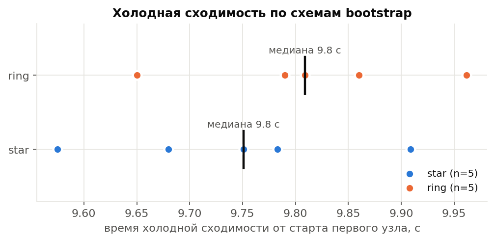
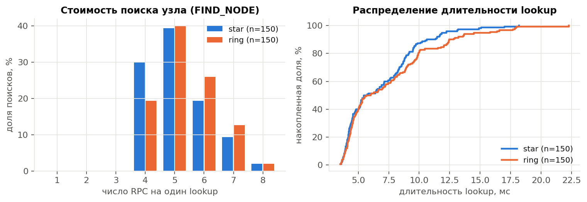
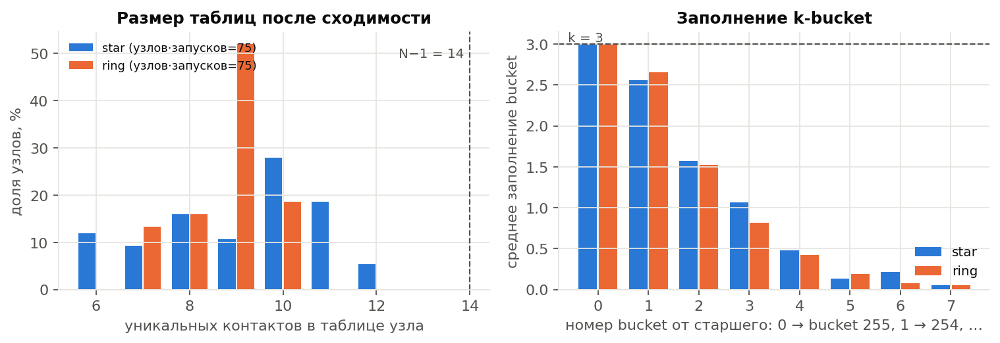
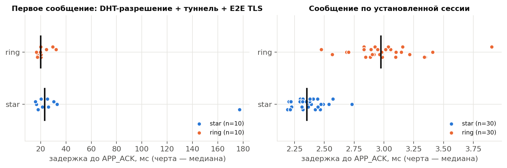
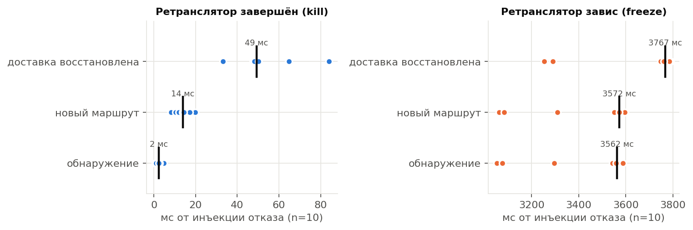
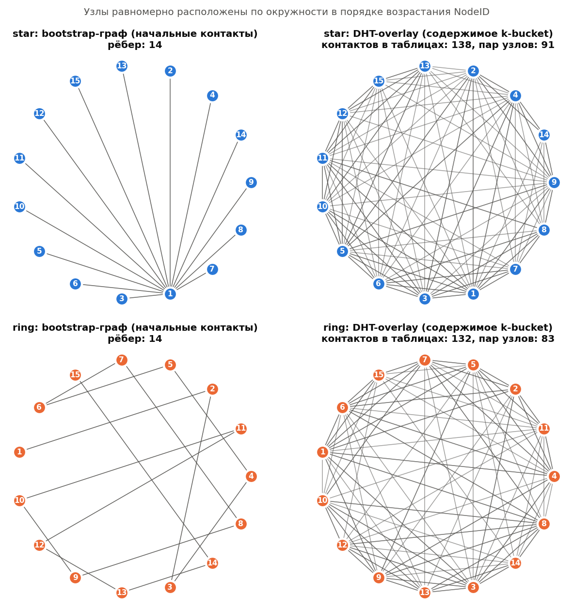

# Результаты серии `experiments-20261026-053315`

Версия кода: `5ebcc62`; N=15, k=3, ALPHA=3, R=3; исследуемый фактор — схема bootstrap (star, ring); 5 холодных запусков на схему; полная батарея отказов — в запуске 1 каждой схемы.

## Схема star

| Показатель | n | min | max | медиана | среднее | p95 |
|---|---:|---:|---:|---:|---:|---:|
| Холодная сходимость, с | 5 | 9.57 | 9.91 | 9.75 | 9.74 | n<20 |
| Присоединение всех узлов, с | 5 | 9.27 | 9.64 | 9.48 | 9.47 | n<20 |
| Раундов до сходимости | 5 | 2 | 2 | 2 | 2 | n<20 |
| Контактов в таблице узла | 75 | 6.0 | 12.0 | 10.0 | 9.1 | 11.3 |
| Lookup: длительность, мс | 150 | 3.6 | 18.2 | 5.6 | 6.8 | 12.1 |
| Lookup: RPC | 150 | 4.0 | 8.0 | 5.0 | 5.1 | 7.0 |
| Lookup: итераций | 150 | 2.0 | 3.0 | 2.0 | 2.1 | 3.0 |
| Lookup: промежуточных узлов | 150 | 3.0 | 7.0 | 4.0 | 4.1 | 6.0 |
| Отказ промежуточного узла: lookup, мс | 5 | 2033.5 | 2056.1 | 2042.3 | 2044.3 | n<20 |
| Отказ хранителя: FIND_VALUE, мс | 5 | 3.2 | 2050.3 | 2039.0 | 1634.2 | n<20 |
| Построение туннеля, мс | 10 | 3.7 | 10.5 | 8.0 | 7.0 | n<20 |
| Первое сообщение, мс | 10 | 15.8 | 177.1 | 23.3 | 38.3 | n<20 |
| Сообщение по установленной сессии, мс | 30 | 2.19 | 2.73 | 2.35 | 2.37 | 2.56 |
| Отказ ретранслятора (kill): обнаружение, мс | 5 | 0.5 | 4.8 | 2.5 | 2.4 | n<20 |
| Отказ ретранслятора (kill): восстановление доставки, мс | 5 | 33.2 | 64.7 | 48.3 | 48.8 | n<20 |
| Зависание ретранслятора: обнаружение, мс | 5 | 3051.6 | 3578.5 | 3564.4 | 3413.6 | n<20 |
| Зависание ретранслятора: восстановление доставки, мс | 5 | 3253.1 | 3790.1 | 3772.3 | 3669.1 | n<20 |

- Успешных контрольных lookup: **150/150**; цель отсутствовала в таблице инициатора во всех 150 из 150.
- Невырожденность (запуск 1): выполнена; узлов с < N−1 контактов: 100%; максимальная таблица 11 при N−1=14.
- Доставлено сообщений: 40/40 (недоставленные в статистику задержек не входят).
- FIND_VALUE после отказа хранителя: 5/5; lookup после отключения bootstrap: 10/10.
- Отказ ретранслятора: доставка восстановлена в 5/5 инъекций, новый маршрут без отказавшего узла — 5/5.

## Схема ring

| Показатель | n | min | max | медиана | среднее | p95 |
|---|---:|---:|---:|---:|---:|---:|
| Холодная сходимость, с | 5 | 9.65 | 9.96 | 9.81 | 9.81 | n<20 |
| Присоединение всех узлов, с | 5 | 9.35 | 9.66 | 9.53 | 9.52 | n<20 |
| Раундов до сходимости | 5 | 2 | 2 | 2 | 2 | n<20 |
| Контактов в таблице узла | 75 | 7.0 | 10.0 | 9.0 | 8.8 | 10.0 |
| Lookup: длительность, мс | 150 | 3.5 | 22.3 | 5.9 | 7.4 | 15.2 |
| Lookup: RPC | 150 | 4.0 | 8.0 | 5.0 | 5.4 | 7.0 |
| Lookup: итераций | 150 | 2.0 | 3.0 | 2.0 | 2.1 | 3.0 |
| Lookup: промежуточных узлов | 150 | 3.0 | 7.0 | 4.0 | 4.4 | 6.0 |
| Отказ промежуточного узла: lookup, мс | 5 | 2024.3 | 2049.5 | 2046.2 | 2041.6 | n<20 |
| Отказ хранителя: FIND_VALUE, мс | 5 | 2.0 | 2055.0 | 2039.2 | 1633.6 | n<20 |
| Построение туннеля, мс | 10 | 2.6 | 11.4 | 6.1 | 6.2 | n<20 |
| Первое сообщение, мс | 10 | 16.5 | 32.0 | 20.1 | 21.8 | n<20 |
| Сообщение по установленной сессии, мс | 30 | 2.47 | 3.90 | 2.98 | 3.01 | 3.38 |
| Отказ ретранслятора (kill): обнаружение, мс | 5 | 1.0 | 2.7 | 2.2 | 1.9 | n<20 |
| Отказ ретранслятора (kill): восстановление доставки, мс | 5 | 48.2 | 84.0 | 50.1 | 59.1 | n<20 |
| Зависание ретранслятора: обнаружение, мс | 5 | 3075.0 | 3586.8 | 3559.3 | 3469.8 | n<20 |
| Зависание ретранслятора: восстановление доставки, мс | 5 | 3289.9 | 3790.3 | 3762.1 | 3677.6 | n<20 |

- Успешных контрольных lookup: **150/150**; цель отсутствовала в таблице инициатора во всех 150 из 150.
- Невырожденность (запуск 1): выполнена; узлов с < N−1 контактов: 100%; максимальная таблица 9 при N−1=14.
- Доставлено сообщений: 40/40 (недоставленные в статистику задержек не входят).
- FIND_VALUE после отказа хранителя: 5/5; lookup после отключения bootstrap: 10/10.
- Отказ ретранслятора: доставка восстановлена в 5/5 инъекций, новый маршрут без отказавшего узла — 5/5.

Примечание. Длительности внутри узла (lookup, построение туннеля, RTT сообщения) измерены монотонными часами высокого разрешения. Времена отказа ретранслятора сравнивают системные часы оркестратора и узла (разрешение около 1 мс): значения 0 ± 1 мс означают обнаружение в пределах разрешения часов.

## Графики

